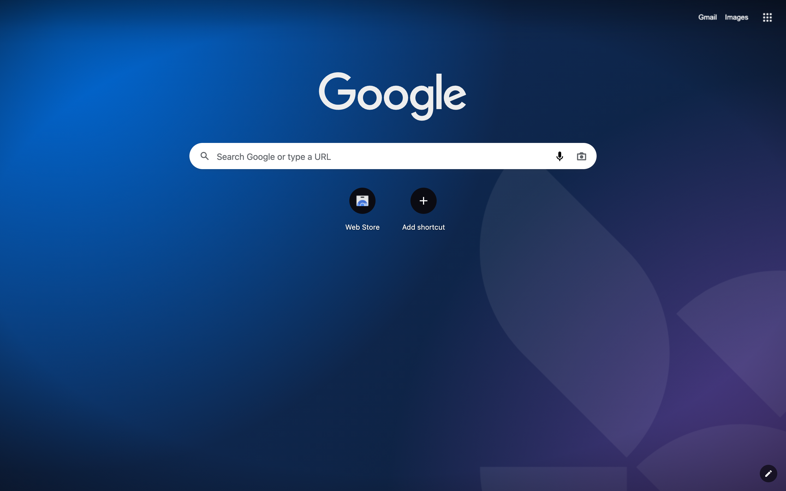

# LangChain Theme for Google Chrome

Light and dark Chrome themes generated from [Macaw](https://github.com/langchain-ai/macaw-design-system), LangChain's design system.



## Install

1. Download `langchain-dark-*.zip` or `langchain-light-*.zip` from the [latest release](https://github.com/darieldatoon/langchain-chrome-theme/releases/latest) and unzip it.
2. Open `chrome://extensions`, turn on **Developer mode**, click **Load unpacked**, and pick the unzipped folder.

Chrome themes have one set of colors, so they can't follow your system's light or dark mode. Install the one you want; loading the other replaces it. To go back to Chrome's default, use **Reset to default** in _Customize Chrome_.

## What it changes

| Chrome                         | Macaw token                                             |
| ------------------------------ | ------------------------------------------------------- |
| Tab strip (`frame`)            | `--bg-surface-level-2`                                  |
| Active tab and toolbar         | `--bg-surface-level-1`                                  |
| Address bar                    | `--bg-surface-level-3`, `--text-primary`                |
| Tab, toolbar and bookmark text | `--text-primary`, `--text-tertiary`, `--text-secondary` |
| New Tab page                   | `--bg-surface-level-1`, links `--text-brand-secondary`  |

The layout matches the VS Code theme: the tab strip is the editor's tab bar, the active tab is the editor. LangChain Dark adds a New Tab background: the brand gradient with a faint logomark. LangChain Light keeps a plain New Tab page, because Chrome styles any New Tab image as a dark one (white logo and links).

## How it works

`src/generate.ts` reads `tokens.json` from the installed `@langchain/macaw-tokens`, resolves each `var()` chain, layers the `html.dark` overrides for the dark variant, and writes `themes/*/manifest.json` with `package.json`'s version. `scripts/render-images.ts` renders the icons and New Tab background with Playwright.

Tests check every color key against Chromium's list of theme colors, and that text and icons meet WCAG contrast on their backgrounds.

## Updating Macaw

Dependabot opens a PR when `@langchain/macaw-tokens` releases. CI fails until the manifests are regenerated:

```sh
gh pr checkout <number>
mise run generate
git commit -am "chore: regenerate themes" && git push
```

If the brand colors changed, run `mise run images` and `mise run screenshots` too.

## Releasing

```sh
mise run release patch   # or minor / major: bumps package.json and the manifests, commits, tags
git push origin main --follow-tags
```

The tag starts `.github/workflows/release.yml`, which checks, tests, zips both themes and publishes a GitHub release with the zips attached. The same zips are what the Chrome Web Store takes.

## Tasks

| Task                      | What it does                                                 |
| ------------------------- | ------------------------------------------------------------ |
| `mise run setup`          | Install dependencies through Socket Firewall, then git hooks |
| `mise run generate`       | Rewrite `themes/*/manifest.json` from the installed tokens   |
| `mise run images`         | Re-render the icons and New Tab background                   |
| `mise run check`          | Format, lint, type check, and fail on stale manifests        |
| `mise run test`           | Unit and contrast tests                                      |
| `mise run package`        | Zip each theme into `dist/`                                  |
| `mise run release <bump>` | Bump the version, commit and tag                             |
| `mise run screenshots`    | Capture `docs/images/new-tab-dark.png` from Chromium         |
